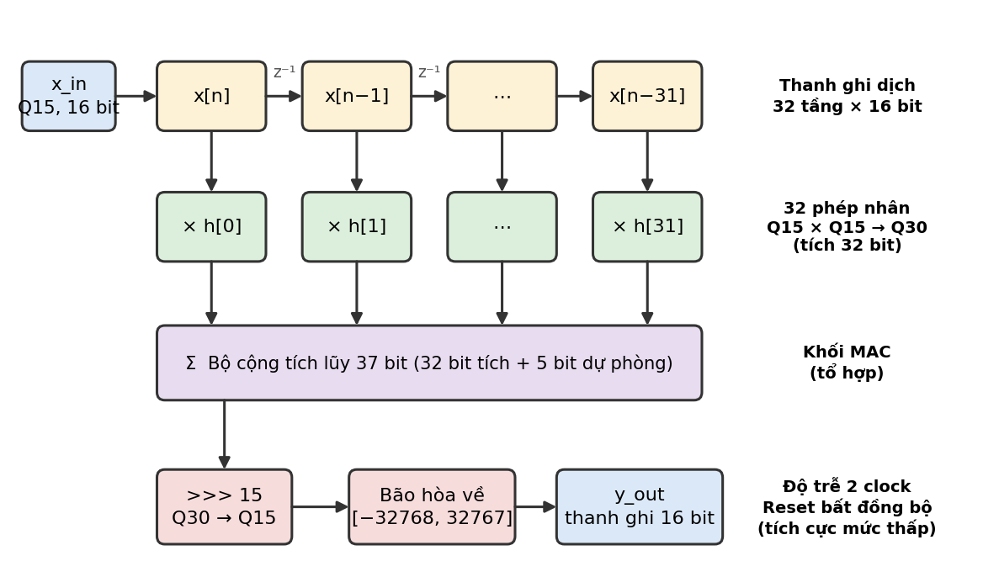
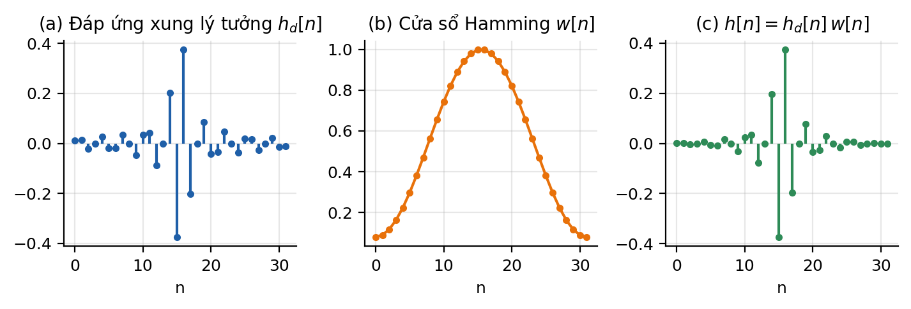
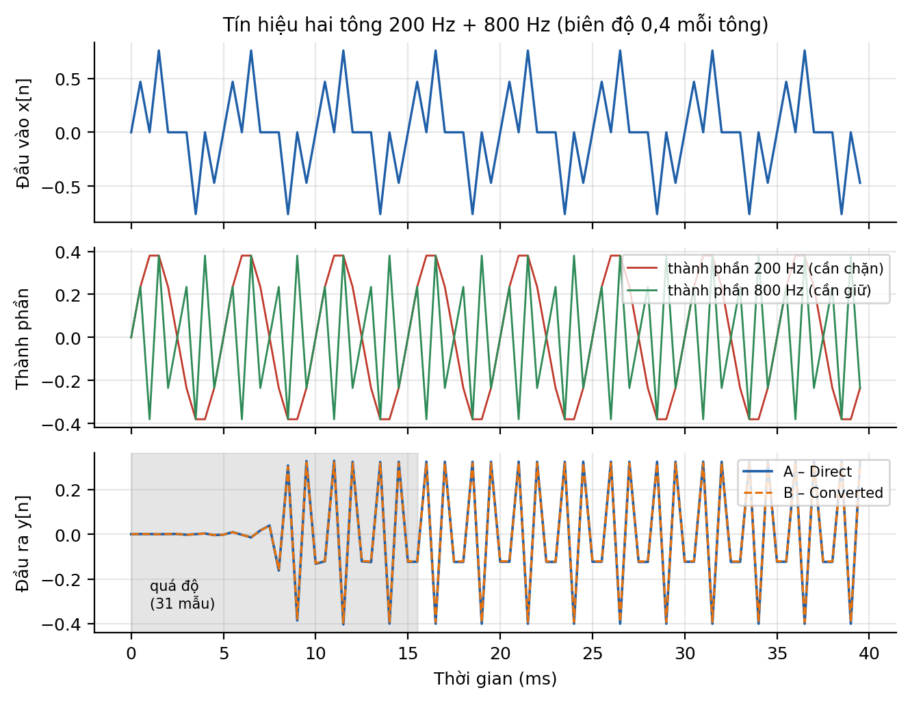
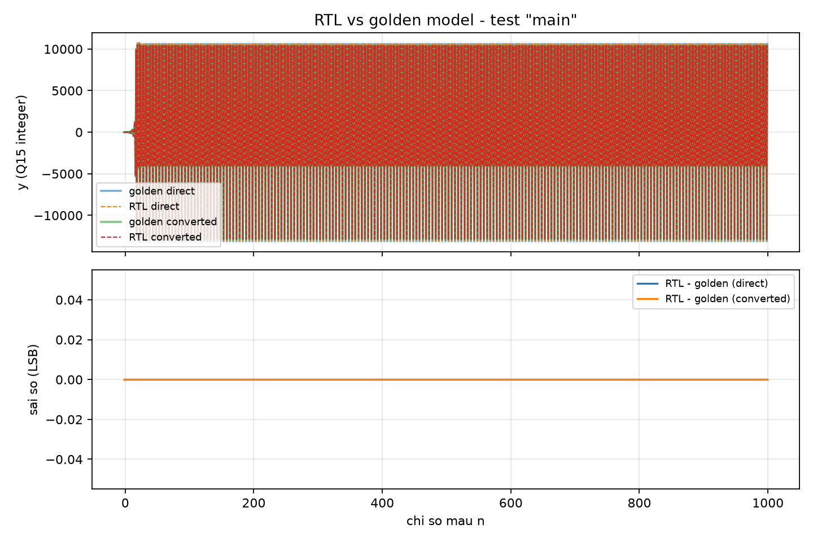
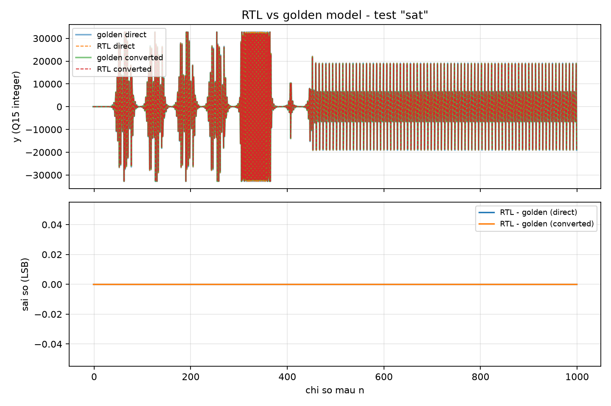

# 32-tap Q15 FIR High-Pass Filter — MATLAB · Verilog · ModelSim


A **32-tap FIR high-pass digital filter** using **Q15 (16-bit signed)** data, a sampling frequency of 2000 Hz and a cutoff frequency of 600 Hz.
The project covers the full design-and-verification chain: **MATLAB (golden model) → hex files → Verilog RTL → ModelSim testbench → bit-by-bit comparison**.

Two design flows are compared with each other:

| Flow | How the coefficients are obtained | RTL module |
|---|---|---|
| **A – Direct** | Window method (Hamming) with an ideal **Type IV** impulse response | `fir32_highpass_direct` |
| **B – Converted** | Take an existing low-pass filter (`fir32_lowpass_ref.v`, 400 Hz) and multiply its coefficients by $(-1)^n$ (spectrum shift) | `fir32_highpass_converted` |

> Full report (theory, derivations, data): [`Bao_cao_FIR_High_Pass_Filter.docx`](Bao_cao_FIR_High_Pass_Filter.docx) (in Vietnamese)

---

## Table of contents

1. [Key results](#1-key-results)
2. [High-level block diagram](#2-high-level-block-diagram)
3. [Repository structure](#3-repository-structure)
4. [Signal description](#4-signal-description)
5. [Module description](#5-module-description)
6. [Mathematical background](#6-mathematical-background)
7. [Golden model](#7-golden-model)
8. [How to run](#8-how-to-run)
9. [ModelSim simulation and waveforms](#9-modelsim-simulation-and-waveforms)
10. [Detailed results and figures](#10-detailed-results-and-figures)
11. [Direct vs Converted comparison](#11-direct-vs-converted-comparison)
12. [Code walkthrough (Q&A)](#12-code-walkthrough-qa)
13. [Limitations and future work](#13-limitations-and-future-work)
14. [References](#14-references)
15. [Authors and license](#15-authors-and-license)

---

## 1. Key results

| Metric | A – Direct | B – Converted |
|---|---|---|
| Number of taps / format | 32 / Q15 | 32 / Q15 |
| Linear-phase type | Type IV (antisymmetric, even N) | Type IV |
| Stopband peak (0–480 Hz) | −53.6 dB | −53.8 dB |
| Response at 600 Hz ($f_c$) | −6.01 dB | −6.18 dB |
| Attenuation of the 200 Hz tone (stopband) | ≈ 59.9 dB | ≈ 60.5 dB |
| Gain of the 800 Hz tone (passband) | +0.00 dB | −0.17 dB |
| Group delay | 15.5 samples = 7.75 ms | 15.5 samples = 7.75 ms |
| **RTL = golden (`main` test)** | **1002/1002 samples, zero error** | **1002/1002 samples, zero error** |
| **RTL = golden (`sat` test)** | **1002/1002 samples, zero error** (hit +32767: 13 times, −32768: 14 times) | **1002/1002 samples, zero error** (hit +32767: 8 times, −32768: 10 times) |

---

## 2. High-level block diagram

### 2.1. Flow: golden model → hex → RTL → testbench → comparison

<p align="center"></p>

1. **MATLAB** (`fir_design_dual.m`) computes the Q15 coefficients for both flows, generates the test signals, runs the integer golden model and writes the `.hex`/`.txt` files.
2. **Verilog RTL** has hard-coded coefficients (taken from the hex files).
3. **The ModelSim testbench** reads `fir_input*.hex`, feeds both filters, writes `fir_out_*.txt` and self-checks against `fir_expected_*.hex`.
4. **Python** (`compare*.py`) independently compares `fir_out_*.txt` with `fir_expected_*.txt` and produces reports and plots.

### 2.2. Direct Form architecture (delay line, multiply, add, `>>>15`, saturation)

<p align="center"></p>

- **Delay line**: 32 × 16-bit registers (`shift_reg`).
- **Multiply**: 32 signed 16×16 → 32-bit multiplications (Q15 × Q15 = Q30).
- **Add**: combinational accumulation in a **37-bit** accumulator `acc` (32-bit product + 5 guard bits).
- **`>>> 15`**: arithmetic right shift, converting Q30 back to Q15.
- **Saturation**: clamp to [−32768, 32767], then latch into the output register `y_out`.
- **Latency**: 2 clock cycles.

---

## 3. Repository structure

```text
FIR_HIGH_PASS_FILTER/
├── Bao_cao_FIR_High_Pass_Filter.docx      # Report (Word, Vietnamese)
├── README.md
├── docs/images/                           # Figures used in the README
├── highpass_mathlab/highpass_mathlab/     # MATLAB: design + golden model
│   ├── fir_design_dual.m                  #   main script
│   ├── fir32_lowpass_ref.v                #   32-tap reference LPF (coefficient source for flow B)
│   ├── fir_coeff_direct.hex / fir_coeff_converted.hex
│   ├── fir_input.hex / fir_input_sat.hex  #   test signals (main / saturation)
│   ├── fir_expected_{main,sat}_{direct,converted}.hex|txt   # golden answers (1002 lines)
│   ├── validation_report.txt, fir_golden_results.mat
│   └── fir_frequency_response.png, plots/*.png
├── modelsim/modelsim/                     # RTL + testbench + simulation results
│   ├── fir32_highpass_direct.v            #   RTL, flow A
│   ├── fir32_highpass_converted.v         #   RTL, flow B
│   ├── tb_fir32_dual_compare.v            #   dual self-checking testbench
│   ├── run.do                             #   ModelSim script (TEST = main | sat)
│   ├── fir_out_{main,sat}_{direct,converted}.txt            # RTL outputs
│   ├── compare.py, compare_fixed.py, compare_txt.py         # comparison against golden
│   ├── compare_report.txt, comparison_*.{txt,csv,png}, rtl_vs_golden_{main,sat}.png
│   └── transcript, vsim.wlf, *.mpf, work/                   # ModelSim log / waveform / project
├── output/                                # ModelSim screenshots + comparison results
└── reference/                             # Saved copies of the references (HTML/PDF)
```

> Note: the repeated sub-folder names (`highpass_mathlab/highpass_mathlab`, `modelsim/modelsim`) reflect the current repository layout; all paths in this README follow it.

---

## 4. Signal description

### 4.1. Ports of the filter modules (`fir32_highpass_direct` / `fir32_highpass_converted`)

| Signal | Direction | Width | Format | Meaning |
|---|---|---|---|---|
| `clk` | input | 1 bit | – | System clock, rising edge |
| `rst_n` | input | 1 bit | active-low, **asynchronous** | Resets the shift register and `y_out` to 0 |
| `x_in` | input | 16 bits | **Q15 signed**, two's complement | Input sample |
| `y_out` | output (`reg`) | 16 bits | **Q15 signed**, two's complement | Output sample, after `>>>15` and saturation |

Parameters: `TAPS = 32`, `DW = 16` (data width), `CW = 16` (coefficient width), `AW = 37` (accumulator width).

### 4.2. Internal signals

| Signal | Type / width | Meaning |
|---|---|---|
| `coeff[0:31]` | `wire signed [15:0]` | 32 Q15 coefficients hard-coded with `assign` (synthesizable as constants) |
| `shift_reg[0:31]` | `reg signed [15:0]` | Delay line: `shift_reg[0]` is the newest sample, `shift_reg[31]` the oldest |
| `prod` | `reg signed [31:0]` | One product `shift_reg[m] * coeff[m]` (Q30) |
| `acc` | `reg signed [36:0]` | 37-bit accumulator: sum of 32 products, no overflow |
| `acc_shifted` | `wire signed [36:0]` | `acc >>> 15` (Q15) |

### 4.3. Testbench signals (`tb_fir32_dual_compare`)

| Signal | Meaning |
|---|---|
| `clk` | 100 MHz clock (`always #5 clk = ~clk;`) |
| `rst_n`, `x_in` | Shared by both DUTs; `x_in` changes on the falling clock edge |
| `y_out_direct`, `y_out_converted` | Outputs of the two DUTs, sampled on the rising edge |
| `test_data`, `exp_direct`, `exp_conv` | Memories loaded from hex: input and golden answers |
| `err_d`, `err_c` | Number of mismatching samples per flow |
| `sat_hi_*`, `sat_lo_*` | Number of times the output hit +32767 / −32768 |

---

## 5. Module description

| Module | File | Function | Inputs/outputs |
|---|---|---|---|
| `fir32_highpass_direct` | `modelsim/modelsim/fir32_highpass_direct.v` | 32-tap high-pass FIR, Direct Form, **flow A** coefficients (Hamming window, Type IV) | in: `clk`, `rst_n`, `x_in[15:0]`; out: `y_out[15:0]` |
| `fir32_highpass_converted` | `modelsim/modelsim/fir32_highpass_converted.v` | Same architecture, **flow B** coefficients (LPF × $(-1)^n$) | same as above |
| `tb_fir32_dual_compare` | `modelsim/modelsim/tb_fir32_dual_compare.v` | Dual testbench: drives the same `x_in` into both DUTs, writes the outputs, **self-checks every line** against the golden data, counts saturation hits, prints PASS/FAIL | no ports; accepts plusargs `+IN`, `+EXP_D`, `+EXP_C`, `+OUT_D`, `+OUT_C`, `+FINISH` |
| `fir32_lowpass_ref` | `highpass_mathlab/highpass_mathlab/fir32_lowpass_ref.v` | 32-tap reference LPF, used only as the **coefficient source** for flow B (read by MATLAB with `regexp`) | – |

The two RTL modules are **structurally identical**; they differ only in the 32 lines `assign coeff[i] = 16'hXXXX;`.

---

## 6. Mathematical background

Sampling frequency $f_s = 2000$ Hz, $N = 32$, high-pass cutoff $f_c = 600$ Hz $\Rightarrow \omega_c = 2\pi f_c/f_s = 0.6\pi$.

### 6.1. FIR and linear phase

$$y[n]=\sum_{k=0}^{N-1} h[k]\,x[n-k],\qquad H(e^{j\omega})=\sum_{n=0}^{N-1}h[n]\,e^{-j\omega n}$$

If $h[n]=\pm h[N-1-n]$ the phase is linear and the group delay is constant, $\tau_g=(N-1)/2 = 15.5$ samples.

### 6.2. Why Type IV

| Type | Symmetry | $N$ | Forced zeros | Usable as high-pass? |
|---|---|---|---|---|
| I | $h[n]=h[N-1-n]$ | odd | none | yes (but needs odd $N$) |
| II | $h[n]=h[N-1-n]$ | even | $H(\pi)=0$ | **no** (blocks the highest frequencies) |
| III | $h[n]=-h[N-1-n]$ | odd | $H(0)=H(\pi)=0$ | no |
| **IV** | $h[n]=-h[N-1-n]$ | **even** | $H(0)=0$ | **yes** |

With $N=32$ (even) we choose **Type IV**. The ideal frequency response must be purely imaginary, multiplied by the delay $\alpha=(N-1)/2=15.5$:

$$H_d(e^{j\omega})=-j\,\mathrm{sgn}(\omega)\,e^{-j\omega\alpha},\qquad \omega_c\le|\omega|\le\pi$$

The inverse Fourier transform gives ($t=n-\alpha$):

$$h_d[n]=\frac{\cos(\omega_c t)-\cos(\pi t)}{\pi t}\;\xrightarrow{\;t\ \text{half-integer}\Rightarrow\cos\pi t=0\;}\;h_d[n]=\frac{\cos(\omega_c t)}{\pi t}$$

(this is the line `h_ideal = cos(omega_hp*t) ./ (pi*t)` in `fir_design_dual.m`).

### 6.3. Hamming window

$$w[n]=0.54-0.46\cos\!\left(\frac{2\pi n}{N-1}\right),\quad 0\le n\le N-1,\qquad h[n]=h_d[n]\,w[n]$$

Truncating the infinite impulse response causes the Gibbs phenomenon; the Hamming window reduces the ripple and gives a stopband attenuation of about 53 dB (≈ 53.6 dB measured), at the cost of a wider transition band.



### 6.4. Spectrum shift by $(-1)^n$ (flow B)

$$h_{HP}[n]=(-1)^n\,h_{LP}[n]\iff H_{HP}(e^{j\omega})=H_{LP}(e^{j(\omega-\pi)})$$

$$f_{c,HP}=\frac{f_s}{2}-f_{c,LP}=1000-400=600\ \text{Hz},\qquad H_{HP}(e^{j\pi})=H_{LP}(e^{j0})=\sum_n h_{LP}[n]$$

The sum of the reference LPF coefficients is $32112/32768 = 0.97998$ (≈ −0.176 dB), so flow B has a passband gain of about −0.18 dB.

The two flows are **theoretically equivalent**: with $t=n-15.5$ we have $\sin(\pi t)=(-1)^n$, hence

$$\frac{\cos(0.6\pi t)}{\pi t}=\frac{\sin(\pi t)\sin(0.4\pi t)}{\pi t}=(-1)^n\frac{\sin(0.4\pi t)}{\pi t}$$


> "Spectral inversion" ($\delta[n-\alpha]-h_{LP}[n]$) needs an integer $\alpha$ (odd N), so it **cannot be used** with N = 32.

### 6.5. Q15 arithmetic, `>>>15` and the 37-bit bound

- **Q15**: a 16-bit signed integer, real value = integer / $2^{15}$, range $[-1,\,1-2^{-15}]$.
  Coefficient quantization: $h_q[n]=\mathrm{clip}\big(\mathrm{round}(2^{15}h[n]),-32768,32767\big)$.
- **Multiplication**: Q15 × Q15 = **Q30** (32-bit product).
- **Accumulator bound**: $|x|\le 2^{15}$, $|h|\le 2^{15}$ ⇒ $|\text{product}|\le 2^{30}$; summing 32 products ⇒ $|acc|\le 32\cdot 2^{30}=2^{35}$. This requires
  $$B_{acc}=2\times 16+\lceil\log_2 32\rceil=32+5=37\ \text{signed bits}$$
- **`>>> 15`**: arithmetic right shift = $\lfloor acc/2^{15}\rfloor$ (rounds toward $-\infty$), converting Q30 back to Q15.
- **Saturation**: $y[n]=\mathrm{sat}_{16}\big(\lfloor acc/2^{15}\rfloor\big)$. Since $\sum|h|=1.556>1$, a large enough input can push the output beyond the Q15 range → saturation is needed instead of letting the value wrap around.

---

## 7. Golden model

The **golden model** is a reference implementation of the algorithm that performs **exactly the same integer operations as the RTL**, so the results match bit for bit (bit-exact) with no tolerance.

- The `simulate_rtl_mac` function in `fir_design_dual.m`:
  1. integer convolution of `x_q15` with `h_q15` (`double` precision is sufficient for Q30 × 32 terms);
  2. `floor(acc / 2^15)` (equivalent to `>>> 15`);
  3. saturation to [−32768, 32767] and counting the saturated samples.
- The expected answers are prefixed with **2 zeros** to match the 2-clock pipeline latency → **1002 lines** (`1000 + LAT`).
- Two tests:
  - **`main`**: two tones, 200 Hz + 800 Hz, amplitude 0.4 each (peak 0.7608, no saturation).
  - **`sat`**: 1000 deterministic full-scale samples that force the output to hit +32767 and −32768, to exercise the saturation branch.
- Generated files: `fir_expected_{main,sat}_{direct,converted}.hex/.txt`.

> Independent check: the coefficients, input signal and expected output were also recomputed with Python/NumPy and match the MATLAB files and the RTL output 100 %.

---

## 8. How to run

### 8.1. MATLAB – design and golden generation

```matlab
cd highpass_mathlab/highpass_mathlab
run('fir_design_dual.m')
```
Generates `fir_coeff_*.hex`, `fir_input*.hex`, `fir_expected_*`, `validation_report.txt` and the plots in `plots/`. If you change any parameter, copy `fir_input*.hex` and `fir_expected_*.hex` to `modelsim/modelsim/` (the repository already contains copies).

### 8.2. ModelSim – RTL simulation

Open ModelSim, `cd` to `modelsim/modelsim`, then in the Transcript window:

```tcl
do run.do                    ;# main test (two tones)
set TEST sat ; do run.do     ;# saturation test
```
`run.do` compiles (`vlog`), simulates (`vsim`), adds the waves and stops at `$stop`. The testbench prints PASS/FAIL directly in the Transcript.

### 8.3. Python – compare RTL against golden

Requirements: Python 3, `numpy` (and `matplotlib` if you want the plots).

```bash
cd modelsim/modelsim
python compare.py                     # main + sat, both flows
python compare_fixed.py --test all    # version with command-line options (--test main|sat|all)
python compare_txt.py                 # compare one file pair (default main_direct), writes CSV
```
Outputs: `compare_report.txt`, `comparison_report.txt`, `comparison_details.csv`, `rtl_vs_golden_<test>.png`.

---

## 9. ModelSim simulation and waveforms

Transcript of the `main` run (ModelSim – Intel FPGA Edition 2020.1): compilation with **0 errors, 0 warnings**, simulation stopped at 10,046 ns.

```text
 Captured lines : 1002 (expected 1002)
 Direct    : mismatches = 0 | sat +32767 = 0, -32768 = 0
 Converted : mismatches = 0 | sat +32767 = 0, -32768 = 0
 *** PASS: RTL khop 100% voi golden model (bit-exact) ***
```

Signal order in the Wave window (per `run.do`): **Clock/Reset** (`clk`, `rst_n`) → **Input/Output** as analog-step traces (`x_in`, `y_out_direct`, `y_out_converted`, scale −32768…32767).

ModelSim screenshots in [`output/`](output/):

| Image | Content |
|---|---|
|  | Zoomed part of the Wave window: one digital signal on top and three step-like traces below |
|  | Another zoomed part: three step-like traces |
|  | Transcript: 1002 lines, 0 mismatches, PASS |

---

## 10. Detailed results and figures

### 10.1. Filter coefficients


- Antisymmetry $h[n]=-h[31-n]$ holds in both flows; $\sum h = 0$, so $H(0)=0$ exactly.
- The two largest coefficients are at the center: $h[15]=-12233$, $h[16]=+12233$ (A); $\mp 11995$ (B).
- 6 coefficients are zero (indices 3, 8, 13, 18, 23, 28) because $\sin(0.4\pi t)=0$ at $t=\pm2.5;\pm7.5;\pm12.5$.

### 10.2. Frequency response


| Frequency | A – Direct (dB) | B – Converted (dB) |
|---|---|---|
| 200 Hz (stopband tone) | −59.83 | −60.54 |
| 600 Hz ($f_c$) | −6.01 | −6.18 |
| 800 Hz (passband tone) | +0.00 | −0.17 |
| 1000 Hz (Nyquist) | −0.00 | −0.18 |

Original MATLAB figures: [`fir_frequency_response.png`](highpass_mathlab/highpass_mathlab/fir_frequency_response.png), [`plots/fir_complete_analysis.png`](highpass_mathlab/highpass_mathlab/plots/fir_complete_analysis.png).

### 10.3. Linear phase


### 10.4. Time domain



The output has a 31-sample transient (15.5 ms), after which only the 800 Hz component remains.


### 10.5. RTL waveform vs golden, and error

**`main` test** (two tones) and **`sat` test** (saturation): the RTL curve coincides with the golden one and the error is zero over all 1002 samples.





Error table (from `modelsim/modelsim/compare_report.txt`):

| Test / flow | Lines | Mismatched lines | Max \|error\| | Hit +32767 | Hit −32768 | Result |
|---|---|---|---|---|---|---|
| main / direct | 1002 | 0 | 0 LSB | 0 | 0 | PASS |
| main / converted | 1002 | 0 | 0 LSB | 0 | 0 | PASS |
| sat / direct | 1002 | 0 | 0 LSB | 13 | 14 | PASS |
| sat / converted | 1002 | 0 | 0 LSB | 8 | 10 | PASS |

Per-sample error details: [`comparison_details.csv`](modelsim/modelsim/comparison_details.csv); error plot: [`comparison_error.png`](modelsim/modelsim/comparison_error.png).

---

## 11. Direct vs Converted comparison

**RTL vs golden:** both flows and both tests are **bit-exact** (Section 10.5).

**Direct vs Converted** (same input):

| Test | RMS difference | Max difference | Cause |
|---|---|---|---|
| main | 178.29 LSB | 256 LSB | DC gain of the original LPF = 0.98 |
| sat | 246.85 LSB | 638 LSB | Same, plus the saturation region |

Coefficient data: max difference 238 LSB (at n = 15, 16), mean 30.8125 LSB; $\sum|h|$ = 1.556 (A) and 1.526 (B).

**Recommendation:** use flow A when a standard 0 dB gain and a freely chosen $f_c$ are needed; use flow B when you want to reuse an existing LPF (accepting a 0.17 dB gain offset, which can be compensated by scaling the coefficients by $1/0.98$).

---

## 12. Code walkthrough (Q&A)

**Why are the coefficients written with `wire` + `assign`?**
So the coefficients are constants: the synthesis tool (FPGA/ASIC) can optimize multiplication by a constant (including a zero coefficient) and no memory is needed.

**Why is `acc` 37 bits wide?**
A Q15×Q15 product is 32 bits wide; summing 32 products needs $\lceil\log_2 32\rceil=5$ extra guard bits to avoid overflow in the worst case (Section 6.5).

**What does `acc >>> 15` do, and why `>>>` rather than `>>`?**
It converts Q30 to Q15 with an **arithmetic** right shift (keeping the sign bit). A logical `>>` would corrupt negative numbers. The result is $\lfloor acc/2^{15}\rfloor$ (rounding toward −∞), and the golden model uses `floor` to match.

**Why is saturation needed?**
$\sum|h|=1.556>1$, so a large enough input pushes the output beyond Q15. Clamping to +32767/−32768 is safer than letting the value wrap around and change sign. The `sat` test exercises exactly this branch.

**Why is the latency 2 clocks and why do the golden answers start with 2 zeros?**
One clock for the sample to enter `shift_reg`, one clock for the `y_out` register. The testbench feeds `LAT = 2` extra zero samples to flush the pipeline, giving `1000 + 2 = 1002` lines.

**Why does the testbench change `x_in` on the falling edge and sample `y_out` on the rising edge?**
To avoid a race with the non-blocking assignments (`<=`) inside the DUT.

**Why are 6 coefficients zero?**
Because $f_{c,LP}=0.2f_s$, the sinc function has a zero every 2.5 samples; the window does not move these zeros.

**Why do the two flows differ by 0.17 dB in the passband?**
$H_{HP}(\pi)=H_{LP}(0)=\sum h_{LP}=0.98$ (−0.176 dB): flow B inherits the gain of the original LPF.

**Why not Type I/II/III?**
N = 32 is even, which rules out types I and III; Type II forces $H(\pi)=0$, blocking exactly the high frequencies we want to keep (Section 6.2).

**How can the coefficient table in the RTL be checked quickly?**
Apply a unit impulse (`x_in = 32767` for one sample, then 0): the output must equal the coefficient table (approximately, since 32767 ≈ 1.0).

---

## 13. Limitations and future work

- **The Hamming window** fixes the stopband attenuation at ≈ 53 dB; for more, use Kaiser/Blackman or Parks–McClellan (`firpm`).
- **Transition band** ≈ 165 Hz (−50 dB → −1 dB), inversely proportional to N.
- **`floor` rounding** introduces an average bias of −0.5 LSB; $2^{14}$ can be added before the shift (the golden model must be changed too).
- **Combinational architecture**: 32 multipliers + an adder tree in one clock cycle → a long critical path. Possible improvements: pipelining, transposed form, or folding the symmetric pairs
  $$y[n]=\sum_{k=0}^{15}h[k]\big(x[n-k]-x[n-31+k]\big)$$
  (16 multipliers, or 13 after dropping the zero coefficients).
- No synthesis or resource/timing analysis yet (Quartus/Vivado); the 100 MHz clock is used only for functional simulation.
- Additional tests worth adding: unit impulse, frequency sweep (chirp) and white noise.

---

## 14. References

**Books / textbooks**

1. A. V. Oppenheim, R. W. Schafer, *Discrete-Time Signal Processing*, 3rd ed., Pearson, 2010. (Linear-phase FIR, the four FIR types, window method.)
2. J. G. Proakis, D. G. Manolakis, *Digital Signal Processing: Principles, Algorithms, and Applications*, 4th ed., Pearson, 2007.
3. S. K. Mitra, *Digital Signal Processing: A Computer-Based Approach*, 4th ed., McGraw-Hill, 2011.
4. S. W. Smith, *The Scientist and Engineer's Guide to Digital Signal Processing*, California Technical Publishing, 1997 — Chapter 16 *Windowed-Sinc Filters* (copy in `reference/ch16.pdf`); Chapter 14 *High-pass, band-pass and band-reject filters*.
5. J. O. Smith III, *Spectral Audio Signal Processing*, W3K Publishing, 2011 (CCRMA, Stanford).

**Online resources** (saved copies in [`reference/`](reference/))

6. J. O. Smith III, *Hamming Window* — <https://www.dsprelated.com/freebooks/sasp/Hamming_Window.html>
7. J. O. Smith III, *Comparison to the Optimal Chebyshev FIR Bandpass Filter* (transition-band width) — <https://ccrma.stanford.edu/~jos/sasp/Comparison_Optimal_Chebyshev_FIR.html>
8. J. O. Smith III, *Preparing the Desired Impulse Response* (window method, half-sample delay) — <https://ccrma.stanford.edu/~jos/sasp/Filtering_Windowing_Ideal_Hilbert_Transform.html>
9. S. Arar, *FIR Filter Design by Windowing: Concepts and the Rectangular Window*, All About Circuits — <https://www.allaboutcircuits.com/technical-articles/finite-impulse-response-filter-design-by-windowing-part-i-concepts-and-rect/>
10. E. W. Weisstein, *Hamming Function*, Wolfram MathWorld — <https://mathworld.wolfram.com/HammingFunction.html>
11. SciPy, `scipy.signal.windows.hamming` — <https://docs.scipy.org/doc/scipy/reference/generated/scipy.signal.windows.hamming.html>
12. Eclipse Audio, *The Complete FIR Filter Guide for Loudspeaker Audio Optimization* — <https://eclipseaudio.com/fir-filter-guide/>

**Additional (Q15, simulation)**

13. Wikipedia, *Q (number format)* — <https://en.wikipedia.org/wiki/Q_(number_format)>
14. Wikipedia, *Finite impulse response* — <https://en.wikipedia.org/wiki/Finite_impulse_response>
15. MathWorks, `fir1` — <https://www.mathworks.com/help/signal/ref/fir1.html>
16. Intel, *ModelSim – Intel FPGA Edition Simulation Quick-Start* — <https://intel.com/content/www/us/en/docs/programmable/683305/19-4/compile-and-simulate-the-design.html>

---

## 15. Authors and license

- **Author:** SE201733 Huynh Thien Vu, SE204273 Hoang Minh Nhat
- **Supervisor:** ThS. Pham The Vinh
