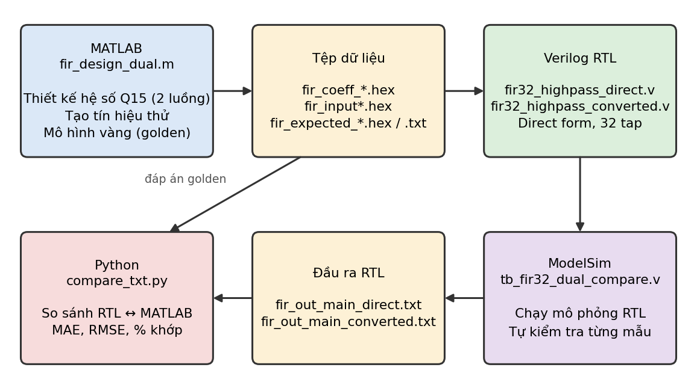
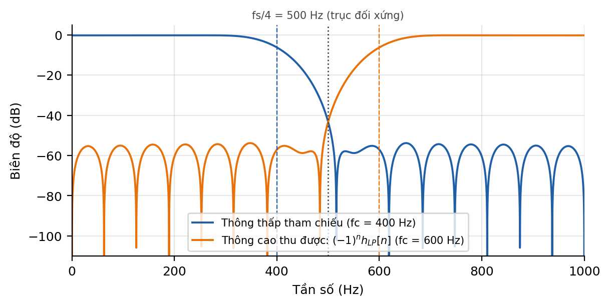
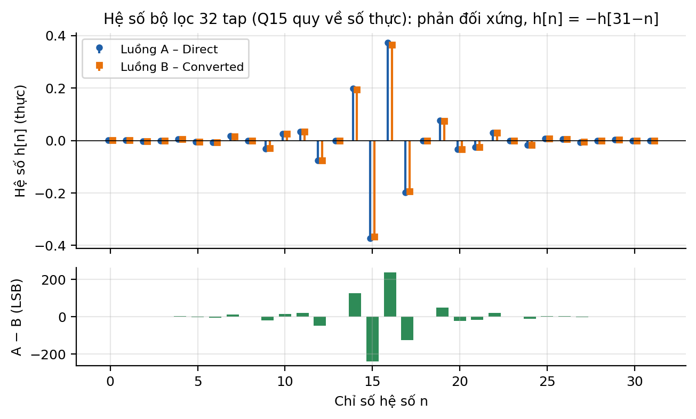
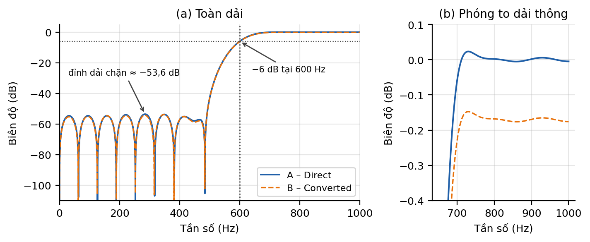
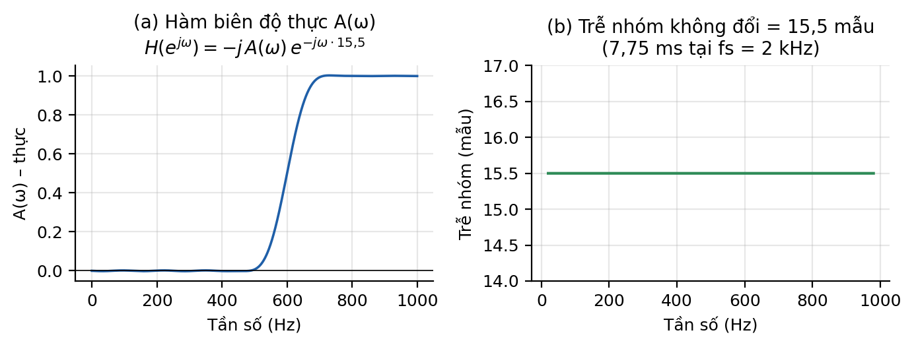
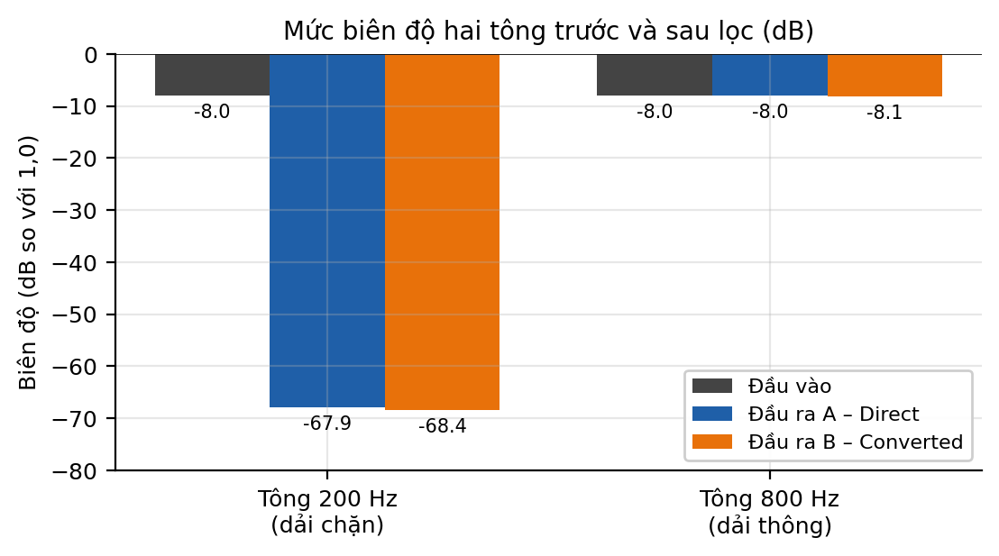

# FIR High-Pass Filter 32 tap (Q15) — MATLAB · Verilog · ModelSim


Bộ lọc số **FIR thông cao 32 hệ số**, dữ liệu **Q15 (16 bit có dấu)**, tần số lấy mẫu 2000 Hz, tần số cắt 600 Hz.
Dự án đi trọn chuỗi thiết kế – kiểm chứng: **MATLAB (golden model) → file hex → Verilog RTL → testbench ModelSim → so sánh từng bit**.

Hai luồng thiết kế được so sánh với nhau:

| Luồng | Cách tạo hệ số | Module RTL |
|---|---|---|
| **A – Direct** | Phương pháp cửa sổ (Hamming) với đáp ứng xung lý tưởng **Type IV** | `fir32_highpass_direct` |
| **B – Converted** | Lấy bộ lọc thông thấp có sẵn (`fir32_lowpass_ref.v`, 400 Hz) rồi nhân hệ số với $(-1)^n$ (đổi phổ) | `fir32_highpass_converted` |

> Báo cáo đầy đủ (lý thuyết, chứng minh, số liệu): [`Bao_cao_FIR_High_Pass_Filter.docx`](Bao_cao_FIR_High_Pass_Filter.docx)

---

## Mục lục

1. [Kết quả chính](#1-kết-quả-chính)
2. [Sơ đồ khối tổng thể (high-level)](#2-sơ-đồ-khối-tổng-thể-high-level)
3. [Cấu trúc thư mục](#3-cấu-trúc-thư-mục)
4. [Mô tả tín hiệu (signal)](#4-mô-tả-tín-hiệu-signal)
5. [Mô tả từng module](#5-mô-tả-từng-module)
6. [Cơ sở toán học](#6-cơ-sở-toán-học)
7. [Golden model](#7-golden-model)
8. [Cách chạy](#8-cách-chạy)
9. [Mô phỏng ModelSim và waveform](#9-mô-phỏng-modelsim-và-waveform)
10. [Kết quả chi tiết và hình ảnh](#10-kết-quả-chi-tiết-và-hình-ảnh)
11. [So sánh Direct và Converted](#11-so-sánh-direct-và-converted)
12. [Giải thích code (hỏi – đáp)](#12-giải-thích-code-hỏi--đáp)
13. [Hạn chế và hướng phát triển](#13-hạn-chế-và-hướng-phát-triển)
14. [Tài liệu tham khảo](#14-tài-liệu-tham-khảo)
15. [Tác giả và giấy phép](#15-tác-giả-và-giấy-phép)

---

## 1. Kết quả chính

| Chỉ tiêu | A – Direct | B – Converted |
|---|---|---|
| Số hệ số / định dạng | 32 / Q15 | 32 / Q15 |
| Loại pha tuyến tính | Type IV (phản đối xứng, N chẵn) | Type IV |
| Đỉnh dải chặn (0–480 Hz) | −53,6 dB | −53,8 dB |
| Đáp ứng tại 600 Hz ($f_c$) | −6,01 dB | −6,18 dB |
| Suy giảm tông 200 Hz (dải chặn) | ≈ 59,9 dB | ≈ 60,5 dB |
| Độ lợi tông 800 Hz (dải thông) | +0,00 dB | −0,17 dB |
| Trễ nhóm | 15,5 mẫu = 7,75 ms | 15,5 mẫu = 7,75 ms |
| **RTL = golden (bài `main`)** | **1002/1002 mẫu, sai số 0** | **1002/1002 mẫu, sai số 0** |
| **RTL = golden (bài `sat`)** | **1002/1002 mẫu, sai số 0** (chạm +32767: 13 lần, −32768: 14 lần) | **1002/1002 mẫu, sai số 0** (chạm +32767: 8 lần, −32768: 10 lần) |

---

## 2. Sơ đồ khối tổng thể (high-level)

### 2.1. Quy trình Golden model → hex → RTL → testbench → so sánh

<p align="center"></p>

1. **MATLAB** (`fir_design_dual.m`) tính hệ số Q15 cho hai luồng, tạo tín hiệu thử, chạy mô hình vàng bằng số nguyên và ghi các tệp `.hex`/`.txt`.
2. **Verilog RTL** có hệ số "đóng cứng" (lấy từ tệp hex).
3. **Testbench ModelSim** đọc `fir_input*.hex`, cấp vào cả hai bộ lọc, ghi `fir_out_*.txt` và tự so sánh với `fir_expected_*.hex`.
4. **Python** (`compare*.py`) đối chiếu độc lập `fir_out_*.txt` với `fir_expected_*.txt`, xuất báo cáo và đồ thị.

### 2.2. Kiến trúc Direct Form (delay line, nhân, cộng, `>>>15`, bão hòa)

<p align="center"></p>

- **Delay line**: 32 thanh ghi 16 bit (`shift_reg`).
- **Nhân**: 32 phép nhân có dấu 16×16 → 32 bit (Q15 × Q15 = Q30).
- **Cộng**: cộng dồn tổ hợp trong `acc` **37 bit** (32 bit tích + 5 bit dự phòng).
- **`>>> 15`**: dịch phải số học, đưa Q30 về Q15.
- **Bão hòa**: kẹp về [−32768, 32767], rồi chốt vào thanh ghi đầu ra `y_out`.
- **Độ trễ**: 2 chu kỳ clock.

---

## 3. Cấu trúc thư mục

```text
FIR_HIGH_PASS_FILTER/
├── Bao_cao_FIR_High_Pass_Filter.docx      # Báo cáo (Word)
├── README.md
├── docs/images/                           # Hình dùng trong README
├── highpass_mathlab/highpass_mathlab/     # MATLAB: thiết kế + golden model
│   ├── fir_design_dual.m                  #   script chính
│   ├── fir32_lowpass_ref.v                #   LPF 32 tap tham chiếu (nguồn hệ số luồng B)
│   ├── fir_coeff_direct.hex / fir_coeff_converted.hex
│   ├── fir_input.hex / fir_input_sat.hex  #   tín hiệu thử (main / saturation)
│   ├── fir_expected_{main,sat}_{direct,converted}.hex|txt   # đáp án golden (1002 dòng)
│   ├── validation_report.txt, fir_golden_results.mat
│   └── fir_frequency_response.png, plots/*.png
├── modelsim/modelsim/                     # RTL + testbench + kết quả mô phỏng
│   ├── fir32_highpass_direct.v            #   RTL luồng A
│   ├── fir32_highpass_converted.v         #   RTL luồng B
│   ├── tb_fir32_dual_compare.v            #   testbench kép, tự kiểm tra
│   ├── run.do                             #   script ModelSim (TEST = main | sat)
│   ├── fir_out_{main,sat}_{direct,converted}.txt            # đầu ra RTL
│   ├── compare.py, compare_fixed.py, compare_txt.py         # so sánh với golden
│   ├── compare_report.txt, comparison_*.{txt,csv,png}, rtl_vs_golden_{main,sat}.png
│   └── transcript, vsim.wlf, *.mpf, work/                   # nhật ký/sóng/dự án ModelSim
├── output/                                # Ảnh chụp ModelSim + kết quả so sánh
└── reference/                             # Bản lưu các tài liệu tham khảo (HTML/PDF)
```

> Lưu ý: thư mục con lặp tên (`highpass_mathlab/highpass_mathlab`, `modelsim/modelsim`) là cấu trúc hiện tại của repo; các đường dẫn trong README bám đúng cấu trúc này.

---

## 4. Mô tả tín hiệu (signal)

### 4.1. Cổng của module lọc (`fir32_highpass_direct` / `fir32_highpass_converted`)

| Tín hiệu | Hướng | Độ rộng | Định dạng | Ý nghĩa |
|---|---|---|---|---|
| `clk` | vào | 1 bit | – | Xung nhịp hệ thống, cạnh lên |
| `rst_n` | vào | 1 bit | tích cực mức thấp, **bất đồng bộ** | Reset thanh ghi dịch và `y_out` về 0 |
| `x_in` | vào | 16 bit | **Q15 có dấu**, bù hai | Mẫu tín hiệu vào |
| `y_out` | ra (`reg`) | 16 bit | **Q15 có dấu**, bù hai | Mẫu tín hiệu ra, đã dịch `>>>15` và bão hòa |

Tham số (`parameter`): `TAPS = 32`, `DW = 16` (độ rộng dữ liệu), `CW = 16` (độ rộng hệ số), `AW = 37` (độ rộng bộ tích lũy).

### 4.2. Tín hiệu nội bộ

| Tín hiệu | Loại / độ rộng | Ý nghĩa |
|---|---|---|
| `coeff[0:31]` | `wire signed [15:0]` | 32 hệ số Q15 đóng cứng bằng `assign` (tổng hợp được thành hằng số) |
| `shift_reg[0:31]` | `reg signed [15:0]` | Đường trễ: `shift_reg[0]` là mẫu mới nhất, `shift_reg[31]` cũ nhất |
| `prod` | `reg signed [31:0]` | Tích một cặp `shift_reg[m] * coeff[m]` (Q30) |
| `acc` | `reg signed [36:0]` | Bộ tích lũy 37 bit: tổng 32 tích, không tràn |
| `acc_shifted` | `wire signed [36:0]` | `acc >>> 15` (Q15) |

### 4.3. Tín hiệu của testbench (`tb_fir32_dual_compare`)

| Tín hiệu | Ý nghĩa |
|---|---|
| `clk` | Clock 100 MHz (`always #5 clk = ~clk;`) |
| `rst_n`, `x_in` | Dùng chung cho cả hai DUT; `x_in` đổi ở cạnh xuống clock |
| `y_out_direct`, `y_out_converted` | Đầu ra hai DUT, lấy mẫu ở cạnh lên |
| `test_data`, `exp_direct`, `exp_conv` | Bộ nhớ nạp từ hex: đầu vào và đáp án golden |
| `err_d`, `err_c` | Số mẫu sai khác của từng luồng |
| `sat_hi_*`, `sat_lo_*` | Số lần đầu ra chạm +32767 / −32768 |

---

## 5. Mô tả từng module

| Module | File | Chức năng | Cổng vào/ra |
|---|---|---|---|
| `fir32_highpass_direct` | `modelsim/modelsim/fir32_highpass_direct.v` | Lọc FIR thông cao 32 tap, Direct Form, hệ số **luồng A** (cửa sổ Hamming, Type IV) | vào: `clk`, `rst_n`, `x_in[15:0]`; ra: `y_out[15:0]` |
| `fir32_highpass_converted` | `modelsim/modelsim/fir32_highpass_converted.v` | Cùng kiến trúc, hệ số **luồng B** (LPF × $(-1)^n$) | như trên |
| `tb_fir32_dual_compare` | `modelsim/modelsim/tb_fir32_dual_compare.v` | Testbench kép: cấp cùng một `x_in` cho hai DUT, ghi đầu ra, **tự so sánh từng dòng** với golden, đếm số lần bão hòa, in PASS/FAIL | không có cổng; nhận plusargs `+IN`, `+EXP_D`, `+EXP_C`, `+OUT_D`, `+OUT_C`, `+FINISH` |
| `fir32_lowpass_ref` | `highpass_mathlab/highpass_mathlab/fir32_lowpass_ref.v` | LPF 32 tap tham chiếu, chỉ là **nguồn hệ số** cho luồng B (MATLAB đọc bằng `regexp`) | – |

Hai module RTL **giống hệt nhau về cấu trúc**, chỉ khác 32 dòng `assign coeff[i] = 16'hXXXX;`.

---

## 6. Cơ sở toán học

Tần số lấy mẫu $f_s = 2000$ Hz, $N = 32$, tần số cắt thông cao $f_c = 600$ Hz $\Rightarrow \omega_c = 2\pi f_c/f_s = 0{,}6\pi$.

### 6.1. FIR và pha tuyến tính

$$y[n]=\sum_{k=0}^{N-1} h[k]\,x[n-k],\qquad H(e^{j\omega})=\sum_{n=0}^{N-1}h[n]\,e^{-j\omega n}$$

Nếu $h[n]=\pm h[N-1-n]$ thì pha tuyến tính, trễ nhóm không đổi $\tau_g=(N-1)/2 = 15{,}5$ mẫu.

### 6.2. Vì sao là Type IV

| Loại | Đối xứng | $N$ | Không điểm bắt buộc | Dùng cho thông cao? |
|---|---|---|---|---|
| I | $h[n]=h[N-1-n]$ | lẻ | không | được (nhưng cần $N$ lẻ) |
| II | $h[n]=h[N-1-n]$ | chẵn | $H(\pi)=0$ | **không** (chặn mất tần số cao nhất) |
| III | $h[n]=-h[N-1-n]$ | lẻ | $H(0)=H(\pi)=0$ | không |
| **IV** | $h[n]=-h[N-1-n]$ | **chẵn** | $H(0)=0$ | **có** |

Với $N=32$ (chẵn) → chọn **Type IV**. Đáp ứng tần số lý tưởng phải thuần ảo, nhân với trễ $\alpha=(N-1)/2=15{,}5$:

$$H_d(e^{j\omega})=-j\,\mathrm{sgn}(\omega)\,e^{-j\omega\alpha},\qquad \omega_c\le|\omega|\le\pi$$

Biến đổi Fourier ngược cho ($t=n-\alpha$):

$$h_d[n]=\frac{\cos(\omega_c t)-\cos(\pi t)}{\pi t}\;\xrightarrow{\;t\ \text{bán nguyên}\Rightarrow\cos\pi t=0\;}\;h_d[n]=\frac{\cos(\omega_c t)}{\pi t}$$

(đây là dòng `h_ideal = cos(omega_hp*t) ./ (pi*t)` trong `fir_design_dual.m`).

### 6.3. Cửa sổ Hamming

$$w[n]=0{,}54-0{,}46\cos\!\left(\frac{2\pi n}{N-1}\right),\quad 0\le n\le N-1,\qquad h[n]=h_d[n]\,w[n]$$

Cắt cụt đáp ứng xung vô hạn gây hiện tượng Gibbs; cửa sổ Hamming giảm gợn sóng, cho suy giảm dải chặn cỡ 53 dB (đo được ≈ 53,6 dB), đổi lại dải chuyển tiếp rộng hơn.


### 6.4. Đổi phổ bằng $(-1)^n$ (luồng B)

$$h_{HP}[n]=(-1)^n\,h_{LP}[n]\iff H_{HP}(e^{j\omega})=H_{LP}(e^{j(\omega-\pi)})$$

$$f_{c,HP}=\frac{f_s}{2}-f_{c,LP}=1000-400=600\ \text{Hz},\qquad H_{HP}(e^{j\pi})=H_{LP}(e^{j0})=\sum_n h_{LP}[n]$$

Tổng hệ số LPF tham chiếu là $32112/32768 = 0{,}97998$ (≈ −0,176 dB) nên luồng B có độ lợi dải thông ≈ −0,18 dB.

Hai luồng **tương đương về lý thuyết**: với $t=n-15{,}5$ có $\sin(\pi t)=(-1)^n$, nên

$$\frac{\cos(0{,}6\pi t)}{\pi t}=\frac{\sin(\pi t)\sin(0{,}4\pi t)}{\pi t}=(-1)^n\frac{\sin(0{,}4\pi t)}{\pi t}$$



> Phương pháp "spectral inversion" ($\delta[n-\alpha]-h_{LP}[n]$) cần $\alpha$ nguyên (N lẻ) nên **không dùng được** với N = 32.

### 6.5. Số học Q15, `>>>15` và cận 37 bit

- **Q15**: số nguyên có dấu 16 bit, giá trị thực = số nguyên / $2^{15}$, dải $[-1,\,1-2^{-15}]$.
  Lượng tử hóa hệ số: $h_q[n]=\mathrm{clip}\big(\mathrm{round}(2^{15}h[n]),-32768,32767\big)$.
- **Nhân**: Q15 × Q15 = **Q30** (tích 32 bit).
- **Cận bộ tích lũy**: $|x|\le 2^{15}$, $|h|\le 2^{15}$ ⇒ $|\text{tích}|\le 2^{30}$; cộng 32 tích ⇒ $|acc|\le 32\cdot 2^{30}=2^{35}$. Cần
  $$B_{acc}=2\times 16+\lceil\log_2 32\rceil=32+5=37\ \text{bit có dấu}$$
- **`>>> 15`**: dịch phải số học = $\lfloor acc/2^{15}\rfloor$ (làm tròn về $-\infty$), đưa Q30 về Q15.
- **Bão hòa**: $y[n]=\mathrm{sat}_{16}\big(\lfloor acc/2^{15}\rfloor\big)$. Vì $\sum|h|=1{,}556>1$ nên tín hiệu đủ lớn có thể làm đầu ra vượt dải Q15 → cần bão hòa thay vì để tràn số.

---

## 7. Golden model

**Golden model** là bản cài đặt tham chiếu của thuật toán, thực hiện **đúng các phép toán số nguyên như RTL** để kết quả trùng từng bit (bit-exact), không cần dung sai.

- Hàm `simulate_rtl_mac` trong `fir_design_dual.m`:
  1. tích chập số nguyên của `x_q15` với `h_q15` (độ chính xác `double` đủ cho Q30 × 32 số hạng);
  2. `floor(acc / 2^15)` (tương đương `>>> 15`);
  3. bão hòa về [−32768, 32767] và đếm số mẫu bị bão hòa.
- Đáp án mong đợi được thêm **2 số 0 đầu** để khớp độ trễ pipeline 2 clock → **1002 dòng** (`1000 + LAT`).
- Hai bài thử:
  - **`main`**: hai tông 200 Hz + 800 Hz, biên độ 0,4 mỗi tông (đỉnh 0,7608, không bão hòa).
  - **`sat`**: 1000 mẫu full-scale tất định, ép đầu ra chạm +32767 và −32768 để kiểm tra nhánh bão hòa.
- Tệp sinh ra: `fir_expected_{main,sat}_{direct,converted}.hex/.txt`.

> Kiểm chứng độc lập: hệ số, tín hiệu vào và đầu ra mong đợi cũng được tính lại bằng Python/NumPy và trùng 100 % với tệp MATLAB cũng như đầu ra RTL.

---

## 8. Cách chạy

### 8.1. MATLAB – thiết kế và sinh golden

```matlab
cd highpass_mathlab/highpass_mathlab
run('fir_design_dual.m')
```
Sinh `fir_coeff_*.hex`, `fir_input*.hex`, `fir_expected_*`, `validation_report.txt`, đồ thị trong `plots/`. Sao chép `fir_input*.hex` và `fir_expected_*.hex` sang `modelsim/modelsim/` nếu thay đổi tham số (repo đã có sẵn bản sao).

### 8.2. ModelSim – mô phỏng RTL

Mở ModelSim, `cd` tới `modelsim/modelsim`, rồi trong cửa sổ Transcript:

```tcl
do run.do                    ;# bài thử main (2 tông)
set TEST sat ; do run.do     ;# bài thử saturation
```
`run.do` tự biên dịch (`vlog`), chạy (`vsim`), thêm sóng và dừng ở `$stop`. Testbench in kết quả PASS/FAIL ngay trong Transcript.

### 8.3. Python – đối chiếu RTL với golden

Yêu cầu: Python 3, `numpy` (và `matplotlib` nếu muốn vẽ hình).

```bash
cd modelsim/modelsim
python compare.py                     # so sánh main + sat, cả hai luồng
python compare_fixed.py --test all    # bản có tham số dòng lệnh (--test main|sat|all)
python compare_txt.py                 # so sánh 1 cặp tệp (mặc định main_direct), xuất CSV
```
Đầu ra: `compare_report.txt`, `comparison_report.txt`, `comparison_details.csv`, `rtl_vs_golden_<test>.png`.

---

## 9. Mô phỏng ModelSim và waveform

Transcript của lần chạy `main` (ModelSim – Intel FPGA Edition 2020.1): biên dịch **0 lỗi, 0 cảnh báo**, mô phỏng dừng tại 10 046 ns.

```text
 Captured lines : 1002 (expected 1002)
 Direct    : mismatches = 0 | sat +32767 = 0, -32768 = 0
 Converted : mismatches = 0 | sat +32767 = 0, -32768 = 0
 *** PASS: RTL khop 100% voi golden model (bit-exact) ***
```

Thứ tự tín hiệu trong cửa sổ Wave (theo `run.do`): **Clock/Reset** (`clk`, `rst_n`) → **Input/Output** dạng analog-step (`x_in`, `y_out_direct`, `y_out_converted`, thang −32768…32767).

Ảnh chụp từ ModelSim trong thư mục [`output/`](output/):

| Ảnh | Nội dung |
|---|---|
|  | Đoạn phóng to cửa sổ Wave: một tín hiệu số ở trên và ba tín hiệu dạng bậc thang bên dưới |
|  | Đoạn phóng to khác: ba tín hiệu dạng bậc thang |
|  | Transcript: 1002 dòng, 0 sai khác, PASS |

---

## 10. Kết quả chi tiết và hình ảnh

### 10.1. Hệ số bộ lọc



- Phản đối xứng $h[n]=-h[31-n]$ ở cả hai luồng; $\sum h = 0$ nên $H(0)=0$ chính xác.
- Hai hệ số lớn nhất ở tâm: $h[15]=-12233$, $h[16]=+12233$ (A); $\mp 11995$ (B).
- 6 hệ số bằng 0 (chỉ số 3, 8, 13, 18, 23, 28) vì $\sin(0{,}4\pi t)=0$ tại $t=\pm2{,}5;\pm7{,}5;\pm12{,}5$.

### 10.2. Đáp ứng tần số



| Tần số | A – Direct (dB) | B – Converted (dB) |
|---|---|---|
| 200 Hz (tông dải chặn) | −59,83 | −60,54 |
| 600 Hz ($f_c$) | −6,01 | −6,18 |
| 800 Hz (tông dải thông) | +0,00 | −0,17 |
| 1000 Hz (Nyquist) | −0,00 | −0,18 |

Hình gốc từ MATLAB: [`fir_frequency_response.png`](highpass_mathlab/highpass_mathlab/fir_frequency_response.png), [`plots/fir_complete_analysis.png`](highpass_mathlab/highpass_mathlab/plots/fir_complete_analysis.png).

### 10.3. Pha tuyến tính



### 10.4. Miền thời gian


Đầu ra có giai đoạn quá độ 31 mẫu (15,5 ms) rồi chỉ còn thành phần 800 Hz.



### 10.5. Waveform RTL so với golden và sai số

**Bài `main`** (hai tông) và **bài `sat`** (bão hòa): đường RTL trùng khít golden, sai số bằng 0 trên toàn bộ 1002 mẫu.


Bảng sai số (từ `modelsim/modelsim/compare_report.txt`):

| Bài thử / luồng | Số dòng | Dòng lệch | Max \|lỗi\| | Chạm +32767 | Chạm −32768 | Kết quả |
|---|---|---|---|---|---|---|
| main / direct | 1002 | 0 | 0 LSB | 0 | 0 | PASS |
| main / converted | 1002 | 0 | 0 LSB | 0 | 0 | PASS |
| sat / direct | 1002 | 0 | 0 LSB | 13 | 14 | PASS |
| sat / converted | 1002 | 0 | 0 LSB | 8 | 10 | PASS |

Sai số chi tiết từng mẫu: [`comparison_details.csv`](modelsim/modelsim/comparison_details.csv); hình sai số: [`comparison_error.png`](modelsim/modelsim/comparison_error.png).

---

## 11. So sánh Direct và Converted

**RTL so với golden:** cả hai luồng, cả hai bài thử đều **bit-exact** (Mục 10.5).

**Direct so với Converted** (cùng đầu vào):

| Bài thử | RMS lệch | Lệch lớn nhất | Nguyên nhân |
|---|---|---|---|
| main | 178,29 LSB | 256 LSB | Độ lợi một chiều của LPF gốc = 0,98 |
| sat | 246,85 LSB | 638 LSB | Như trên, cộng thêm vùng bão hòa |

Số liệu hệ số: lệch lớn nhất 238 LSB (tại n = 15, 16), trung bình 30,8125 LSB; $\sum|h|$ = 1,556 (A) và 1,526 (B).

**Khuyến nghị:** luồng A khi cần độ lợi chuẩn 0 dB và tự chọn $f_c$; luồng B khi muốn tái sử dụng LPF đã có (chấp nhận lệch 0,17 dB, có thể bù bằng cách nhân hệ số với $1/0{,}98$).

---

## 12. Giải thích code (hỏi – đáp)

**Vì sao hệ số được viết bằng `wire` + `assign`?**
Để hệ số là hằng số, công cụ tổng hợp (FPGA/ASIC) tối ưu được phép nhân với hằng số (kể cả hệ số 0), không cần bộ nhớ.

**Vì sao `acc` rộng 37 bit?**
Tích Q15×Q15 rộng 32 bit; cộng 32 tích cần thêm $\lceil\log_2 32\rceil=5$ bit dự phòng để không tràn trong trường hợp xấu nhất (Mục 6.5).

**`acc >>> 15` làm gì và vì sao dùng `>>>` chứ không phải `>>`?**
Đưa Q30 về Q15 bằng dịch phải **số học** (giữ bit dấu). Phép `>>` logic sẽ làm hỏng số âm. Kết quả là $\lfloor acc/2^{15}\rfloor$ (làm tròn về −∞), và golden model dùng `floor` để khớp.

**Vì sao cần bão hòa?**
$\sum|h|=1{,}556>1$, tín hiệu đủ lớn làm đầu ra vượt Q15. Kẹp về +32767/−32768 an toàn hơn để số tràn đổi dấu. Bài thử `sat` kiểm tra đúng nhánh này.

**Vì sao độ trễ là 2 clock và đáp án golden có 2 số 0 đầu?**
1 clock để mẫu vào `shift_reg`, 1 clock cho thanh ghi `y_out`. Testbench cấp thêm `LAT = 2` mẫu 0 để xả pipeline, nên có `1000 + 2 = 1002` dòng.

**Vì sao testbench đổi `x_in` ở cạnh xuống và lấy mẫu `y_out` ở cạnh lên?**
Tránh đua tranh (race) với các phép gán không chặn (`<=`) trong DUT.

**Vì sao có 6 hệ số bằng 0?**
Do $f_{c,LP}=0{,}2f_s$ nên hàm sinc có điểm không mỗi 2,5 mẫu; cửa sổ không đổi các điểm không này.

**Vì sao hai luồng khác nhau 0,17 dB ở dải thông?**
$H_{HP}(\pi)=H_{LP}(0)=\sum h_{LP}=0{,}98$ (−0,176 dB): luồng B thừa hưởng độ lợi của LPF gốc.

**Vì sao không dùng Type I/II/III?**
N = 32 chẵn loại I, III; Type II buộc $H(\pi)=0$, chặn đúng tần số cao cần giữ (Mục 6.2).

**Làm sao kiểm tra nhanh bảng hệ số trong RTL?**
Cấp một xung đơn vị (`x_in = 32767` một mẫu, rồi 0): đầu ra phải bằng bảng hệ số (xấp xỉ, do 32767 ≈ 1,0).

---

## 13. Hạn chế và hướng phát triển

- **Cửa sổ Hamming** cố định suy giảm dải chặn ≈ 53 dB; muốn sâu hơn dùng Kaiser/Blackman hoặc Parks–McClellan (`firpm`).
- **Dải chuyển tiếp** ≈ 165 Hz (−50 dB → −1 dB), tỉ lệ nghịch với N.
- **Làm tròn `floor`** gây thiên lệch trung bình −0,5 LSB; có thể cộng $2^{14}$ trước khi dịch (cần sửa cả golden).
- **Kiến trúc tổ hợp**: 32 phép nhân + cây cộng trong một chu kỳ → đường tới hạn dài. Hướng cải tiến: pipeline, dạng transposed, hoặc gộp cặp đối xứng
  $$y[n]=\sum_{k=0}^{15}h[k]\big(x[n-k]-x[n-31+k]\big)$$
  (16 phép nhân, còn 13 nếu bỏ hệ số 0).
- Chưa có tổng hợp/đo tài nguyên và định thời (Quartus/Vivado); clock 100 MHz chỉ dùng để mô phỏng chức năng.
- Nên bổ sung bài thử xung đơn vị, quét tần (chirp) và nhiễu trắng.

---

## 14. Tài liệu tham khảo

**Sách / giáo trình**

1. A. V. Oppenheim, R. W. Schafer, *Discrete-Time Signal Processing*, 3rd ed., Pearson, 2010. (FIR pha tuyến tính, 4 loại FIR, phương pháp cửa sổ.)
2. J. G. Proakis, D. G. Manolakis, *Digital Signal Processing: Principles, Algorithms, and Applications*, 4th ed., Pearson, 2007.
3. S. K. Mitra, *Digital Signal Processing: A Computer-Based Approach*, 4th ed., McGraw-Hill, 2011.
4. S. W. Smith, *The Scientist and Engineer's Guide to Digital Signal Processing*, California Technical Publishing, 1997 — Chương 16 *Windowed-Sinc Filters* (có bản `reference/ch16.pdf`); Chương 14 *High-pass, band-pass and band-reject filters*.
5. J. O. Smith III, *Spectral Audio Signal Processing*, W3K Publishing, 2011 (CCRMA, Stanford).

**Tài liệu trực tuyến** (bản lưu trong [`reference/`](reference/))

6. J. O. Smith III, *Hamming Window* — <https://www.dsprelated.com/freebooks/sasp/Hamming_Window.html>
7. J. O. Smith III, *Comparison to the Optimal Chebyshev FIR Bandpass Filter* (độ rộng dải chuyển tiếp) — <https://ccrma.stanford.edu/~jos/sasp/Comparison_Optimal_Chebyshev_FIR.html>
8. J. O. Smith III, *Preparing the Desired Impulse Response* (phương pháp cửa sổ, trễ nửa mẫu) — <https://ccrma.stanford.edu/~jos/sasp/Filtering_Windowing_Ideal_Hilbert_Transform.html>
9. S. Arar, *FIR Filter Design by Windowing: Concepts and the Rectangular Window*, All About Circuits — <https://www.allaboutcircuits.com/technical-articles/finite-impulse-response-filter-design-by-windowing-part-i-concepts-and-rect/>
10. E. W. Weisstein, *Hamming Function*, Wolfram MathWorld — <https://mathworld.wolfram.com/HammingFunction.html>
11. SciPy, `scipy.signal.windows.hamming` — <https://docs.scipy.org/doc/scipy/reference/generated/scipy.signal.windows.hamming.html>
12. Eclipse Audio, *The Complete FIR Filter Guide for Loudspeaker Audio Optimization* — <https://eclipseaudio.com/fir-filter-guide/>

**Thêm (Q15, mô phỏng)**

13. Wikipedia, *Q (number format)* — <https://en.wikipedia.org/wiki/Q_(number_format)>
14. Wikipedia, *Finite impulse response* — <https://en.wikipedia.org/wiki/Finite_impulse_response>
15. MathWorks, `fir1` — <https://www.mathworks.com/help/signal/ref/fir1.html>
16. Intel, *ModelSim – Intel FPGA Edition Simulation Quick-Start* — <https://intel.com/content/www/us/en/docs/programmable/683305/19-4/compile-and-simulate-the-design.html>

---

## 15. Tác giả và giấy phép

- **Tác giả:** _[Họ tên] – [MSSV] – [Lớp]_
- **Giảng viên hướng dẫn:** _[Họ tên]_
- **Giấy phép:** _[Chưa chọn – thêm file `LICENSE` nếu muốn công khai]_
